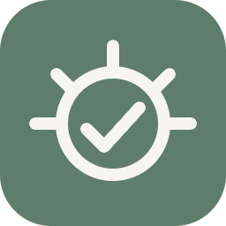
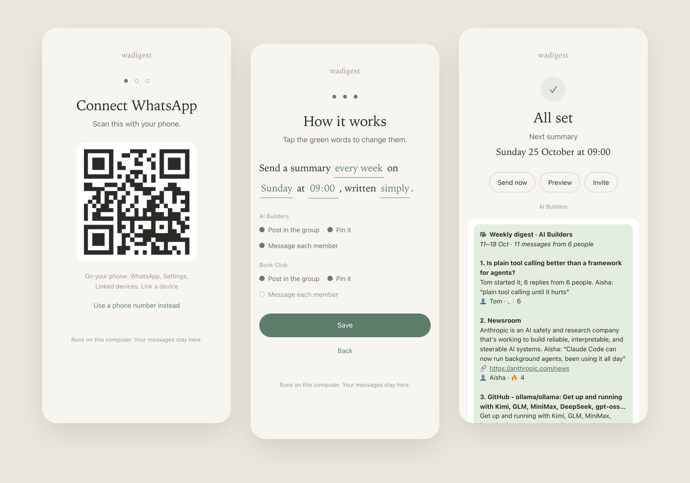

<div align="center">



# wadigest

**The best of your WhatsApp groups, in one calm message.**

Busy group chats bury the good links, videos and conversations. wadigest reads your groups on a schedule, picks the top five, and posts a short summary back into WhatsApp. Nobody has to leave the app.

[](LICENSE)




</div>

## Install

One command. It sets everything up, then opens a page in your browser.

**Mac or Linux** (Terminal):

```bash
curl -fsSL https://raw.githubusercontent.com/sgaabdu4/wadigest/main/get.sh | bash
```

**Windows** (PowerShell):

```powershell
irm https://raw.githubusercontent.com/sgaabdu4/wadigest/main/get.ps1 | iex
```

Or [download the zip](https://github.com/sgaabdu4/wadigest/archive/refs/heads/main.zip), unzip it and double-click **Start wadigest**. Not technical? [START-HERE.md](START-HERE.md) is one page.

## Set it up in three steps

1. **Scan the QR code** with your phone: WhatsApp, Settings, Linked devices, Link a device. wadigest links like WhatsApp Web does.
2. **Tick your groups.** Each one gets its own summary of its own messages.
3. **Say when.** *Send a summary every week on Sunday at 9:00, written simply.* Tap any green word to change it, then press **Start**.

That's it. It runs in the background from then on, and starts again by itself when the computer restarts.

## Why wadigest

- **Stays in WhatsApp.** People don't leave WhatsApp for a website, so the summary comes to them.
- **Short.** The top five links, videos and busy threads, two sentences each, with the links.
- **Fair ranking.** Reactions, replies and re-shares decide what makes the cut, not who posts most.
- **Yours.** It runs on your computer. Your messages stay there.

## What each group gets

For every group you can switch these on or off:

| Switch | What happens |
| --- | --- |
| **Post in the group** | The summary is posted in the group chat |
| **Pin it** | The post is pinned for 7 days, so it stays at the top |
| **Message each member** | Everyone gets their own copy by private message, with their interests first ⭐ |

Members can reply to wadigest by private message, or send in the group:

| Send | It does |
| --- | --- |
| `!digest interests agents, n8n` | Puts those topics first in your copy |
| `!digest stop` | No more private messages (the group post carries on) |
| `!digest join` | Start them again |
| `!digest status` · `!digest help` | What you're signed up for · the list |

**Invite** on the home screen shows a QR code. Anyone can scan it with their phone camera, then press send in WhatsApp to sign up.

## How the summary is written

You choose in the sentence: *written simply*, *with local AI* or *with Claude*. You can change it any time.

| Style | How it works | Good to know |
| --- | --- | --- |
| **Simply** (default) | Ranks the messages and builds the summary from them: titles of the linked pages, what people said, and reactions. | No AI, instant, nothing to install. |
| **With local AI** | The same ranking, then [Ollama](https://ollama.com) with the `llama3.2:3b` model reads the linked pages and writes two sentences per item. | Runs on your computer, nothing leaves it. About a 2 GB download, installed for you. |
| **With Claude** | The same ranking, then Claude reads the linked pages and writes the summary. It uses [Claude Code](https://claude.com/claude-code) if you have it, or an API key. | The best writing. The top items and their page text are sent to Anthropic. |

If an AI style fails for any reason, the simple summary goes out instead, so a summary always arrives.

You can also write the summary somewhere else: `wadigest export --prompt` gives you the week's items and a ready-made prompt, and `wadigest run --summary summary.json` posts what comes back.

## On a server

No screen? It works the same in the terminal. Run the install command over SSH and it asks the same questions as text. The QR code or a phone-number code shows right in the terminal. On Linux it asks the system to keep it running after you log out; if that needs admin rights, it tells you the one command to run.

## Handy commands

```bash
wadigest                # open the page (or the questions, on a server)
wadigest preview        # see the summary now, sends nothing
wadigest run            # send it now (asks first)
wadigest status         # groups, schedule, next send, last send
wadigest doctor         # check everything is working
```

`wadigest help` lists the rest, including `config set schedule.everyDays 3` and `config group "Name" pin off`.

## How live is it?

- **Asleep at send time?** It catches up when the computer wakes, up to 3 days late.
- **Never twice.** Each group gets one post per slot, even after a crash or a restart.
- **Retries.** A failed send is tried again 3 times, 30 minutes apart.
- **Private messages** go out 8 to 20 seconds apart, at most 100 at a time.

## Privacy

- Everything stays in `~/.wadigest` on your computer: the linked WhatsApp session, settings and logs.
- wadigest opens the links people share, to read their titles and text.
- Only with Claude do the top items leave your computer, to Anthropic.
- To remove it, run `bash scripts/uninstall.sh` in the wadigest folder (`~/.wadigest/app` if you used the one command), then remove the device in WhatsApp under Linked devices.

## Good to know

- wadigest uses [wacli](https://github.com/openclaw/wacli), an open-source WhatsApp client. It isn't an official WhatsApp app, and WhatsApp can restrict numbers that send a lot of automated messages. A spare number is safest.
- Pinning needs a small addition to wacli ([`wacli-fork/`](wacli-fork)). The installer downloads it ready-made from this repo's releases. In groups where only admins can pin, the linked number must be an admin.
- Video transcripts are optional on Mac and Linux (`wadigest config set video.enabled on`, with ffmpeg and whisper.cpp).

## Build from source

```bash
git clone https://github.com/sgaabdu4/wadigest.git
cd wadigest
npm test
bash scripts/install.sh
```

No runtime dependencies, just Node 20 or later. `npm test` runs the tests against a fake wacli. Every push to `main` runs them in GitHub Actions, and changes to `wacli-fork/` publish new pinning builds for every system.

## Credits

- Built at the Developer Bros hackathon.
- [wacli](https://github.com/openclaw/wacli) by openclaw, MIT licence. [Ollama](https://ollama.com) for local AI.
- WhatsApp is a trademark of Meta. Claude is a trademark of Anthropic. wadigest is not affiliated with either.
- Screenshots use sample groups and names.

## Licence

[MIT](LICENSE)
